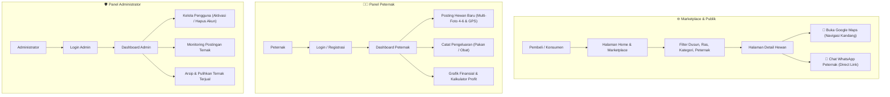
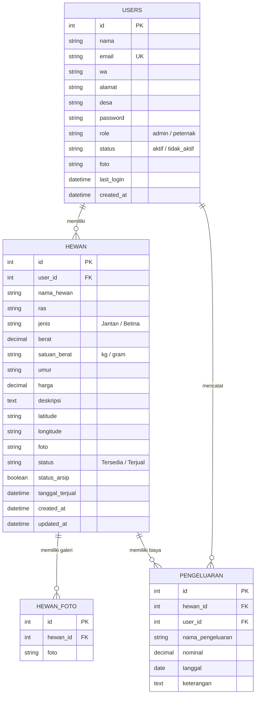

<div align="center">

  # 🐄 TernakApp (SI-PHT)
  ### **Sistem Informasi Penjualan Hewan Ternak & Manajemen Finansial Peternakan**

  <p align="center">
    <b>Platform Marketplace Digital yang Menghubungkan Pembeli dengan Peternak Lokal Tanpa Perantara</b>
  </p>

  <p align="center">
    
    
    
    
    
  </p>

  <p align="center">
    <a href="#-tentang-proyek">Tentang Proyek</a> •
    <a href="#-fitur-unggulan">Fitur Unggulan</a> •
    <a href="#-alur-sistem">Alur Sistem</a> •
    <a href="#-panduan-instalasi">Panduan Instalasi</a> •
    <a href="#-akun-demo">Akun Demo</a> •
    <a href="#-struktur-folder">Struktur Folder</a>
  </p>

</div>

---

## 📖 Tentang Proyek

**TernakApp (SI-PHT)** adalah platform web inovatif yang dirancang untuk mendigitalkan ekosistem perdagangan hewan ternak di tingkat pedesaan (khususnya wilayah **Kecamatan Kemalang, Kabupaten Klaten**). 

Platform ini menyelesaikan dua masalah utama:
1. **Bagi Pembeli / Konsumen**: Memberikan kemudahan mencari hewan ternak (sapi, kambing, domba, unggas) dengan data transparan (harga, bobot, umur, ras, lokasi GPS peternakan) serta komunikasi langsung via WhatsApp tanpa makelar.
2. **Bagi Peternak Lokal**: Membantu memasarkan hewan secara luas, mengelola katalog penjualan, serta mencatat arus kas pengeluaran operasional & pakan untuk menghitung margin keuntungan bersih (*profit/loss*).

---

## ✨ Fitur Unggulan

<table width="100%">
  <tr>
    <td width="33%" valign="top">
      <h3>🛒 Marketplace Publik</h3>
      <ul>
        <li><b>Katalog Responsif:</b> Tampilan kartu hewan modern dengan status ketersediaan.</li>
        <li><b>Multi-Filter Canggih:</b> Filter dinamis berdasarkan Dusun, Jenis Hewan, Ras, dan Nama Peternak.</li>
        <li><b>Detail & Galeri Interaktif:</b> Multi-preview foto resolusi tinggi.</li>
        <li><b>Integrasi Maps & WhatsApp:</b> Direct chat WA dengan teks otomatis & navigasi Google Maps.</li>
      </ul>
    </td>
    <td width="33%" valign="top">
      <h3>👨‍🌾 Dashboard Peternak</h3>
      <ul>
        <li><b>Manajemen Hewan:</b> CRUD postingan hewan ternak.</li>
        <li><b>Multi-Upload Foto:</b> Unggah 4 hingga 6 foto sekaligus dengan validasi instan.</li>
        <li><b>Tracking GPS:</b> Ambil titik koordinat lokasi kandang otomatis via sensor browser.</li>
        <li><b>Manajemen Biaya & Profit:</b> Kalkulasi otomatis <code>Harga Jual - Biaya Operasional</code>.</li>
        <li><b>Statistik & Grafik:</b> Visualisasi tren performa bulanan via Chart.js.</li>
      </ul>
    </td>
    <td width="33%" valign="top">
      <h3>🛡️ Dashboard Admin</h3>
      <ul>
        <li><b>Kelola Pengguna:</b> Monitoring, aktivasi, nonaktifkan, atau hapus akun pengguna.</li>
        <li><b>Monitoring Ternak:</b> Pengawasan seluruh hewan dari semua peternak.</li>
        <li><b>Sistem Pengarsipan:</b> Arsipkan hewan yang telah terjual untuk menjaga kerapihan data aktif.</li>
        <li><b>Proteksi Administrator:</b> Fitur keamanan anti *self-deletion* akun admin yang sedang login.</li>
      </ul>
    </td>
  </tr>
</table>

---

## 🔄 Diagram Alur Sistem & ERD

### 📊 1. Alur Interaksi Pengguna (User Flow)



### 🗄️ 2. Entity Relationship Diagram (ERD)



---

## 🔒 Standar Keamanan & Kualitas Kode

- 🛡️ **Bebas SQL Injection**: 100% kueri database yang melibatkan input pengguna menggunakan **Prepared Statements** (`mysqli_prepare`).
- 🔐 **Proteksi IDOR (Insecure Direct Object References)**: Validasi ketat kepemilikan data (`WHERE id = ? AND user_id = ?`) di setiap aksi edit/hapus peternak.
- 📁 **Keamanan Unggah Berkas**: Whitelist tipe MIME & ekstensi (`jpg`, `jpeg`, `png`, `webp`), pengacakan nama file kriptografis (`bin2hex(random_bytes(4))`), serta penghapusan file fisik saat record dihapus (*cascade unlink*).
- 📐 **Standar Pengodean PSR-12**: Format kode rapi dan terstandardisasi secara konsisten.

---

## 🚀 Panduan Instalasi & Menjalankan

### 📋 Prasyarat
- **PHP** >= 8.0 *(dengan ekstensi `mysqli`, `fileinfo`, `json`)*
- **MySQL / MariaDB**
- **Web Server** *(XAMPP / Laragon / Native Apache)*

---

### 1️⃣ Clone Repositori
Salin repositori ini ke folder root web server Anda (`htdocs` pada XAMPP atau `www` pada Laragon):
```bash
git clone https://github.com/riff122/SI-PHT.git
```

### 2️⃣ Siapkan Basis Data
1. Buka **phpMyAdmin** (`http://localhost/phpmyadmin`) atau terminal MySQL Anda.
2. Buat database baru bernama `ternakapp`:
   ```sql
   CREATE DATABASE ternakapp;
   ```
3. Import berkas [`database.sql`](./database.sql) ke dalam database `ternakapp`.

### 3️⃣ Konfigurasi Koneksi
Periksa konfigurasi koneksi pada [`config/koneksi.php`](./config/koneksi.php):
```php
$host = "localhost";
$user = "root";
$pass = "";
$db   = "ternakapp";
```

### 4️⃣ Akses Aplikasi
Buka peramban favorit Anda dan kunjungi:
```text
http://localhost/SI-PHT/home.php
```

---

## 🔑 Akun Demo Default

Tersedia akun bawaan yang siap langsung digunakan untuk pengujian:

| Role | Email | Password | Hak Akses |
| :--- | :--- | :--- | :--- |
| 🛡️ **Administrator** | `admin@ternakapp.id` | `admin123` | Kelola seluruh pengguna, postingan, arsip |
| 👨‍🌾 **Peternak** | `peternak@ternakapp.id` | `peternak123` | Kelola hewan, input pengeluaran, pantau profit |

---

## 📁 Struktur Direktori

```bash
SI-PHT/
├── 📁 auth/                 # Modul autentikasi login & registrasi
│   ├── login.php
│   └── register.php
├── 📁 config/               # Konfigurasi koneksi MySQL
│   └── koneksi.php
├── 📁 dashboard/            # Modul panel kontrol (Admin & Peternak)
│   ├── admin.php           # Dashboard utama Administrator
│   ├── user.php            # Dashboard utama Peternak
│   ├── 📁 data_hewan/      # Manajemen hewan untuk Administrator
│   ├── 📁 data_user/       # Manajemen akun pengguna untuk Administrator
│   ├── 📁 hewan/           # CRUD data ternak untuk Peternak
│   ├── 📁 pengeluaran/     # Pencatatan operasional & pakan ternak
│   ├── keuntungan.php      # Laporan margin profit / loss
│   ├── lihat_profil.php    # Pratinjau profil publik peternak
│   ├── logout.php          # Proses pengakhiran sesi
│   └── profil.php          # Manajemen profil akun
├── 📁 images/               # Media statis & penyimpanan unggahan foto
│   ├── 📁 hewan/
│   └── 📁 profil/
├── 📄 database.sql          # Skema database relasional & initial seed data
├── 📄 detail.php            # Halaman detail rincian hewan publik
├── 📄 home.php              # Halaman beranda & etalase marketplace
├── 📄 reset.php             # Skrip utilitas redirect sesi
├── 📄 style.css             # Stylesheet styling kustom & glassmorphism
└── 📄 .gitignore            # Konfigurasi filter berkas Git
```

---

## 🛠️ Teknologi yang Digunakan

- **Backend**: Native PHP 8.3 (Structured & Secure)
- **Database**: MySQL / MariaDB (Prepared Statements)
- **Frontend**: HTML5, Vanilla JavaScript, CSS3 (Modern Glassmorphism Design)
- **Framework UI**: Bootstrap 5.3 & Bootstrap Icons
- **Visualisasi Data**: Chart.js
- **Integrasi API**: Google Maps Geolocation Embed API & WhatsApp URL Scheme

---

<div align="center">
  <p>Dikembangkan dengan ❤️ untuk mendukung digitalisasi peternak lokal di Indonesia.</p>
  <p>&copy; 2026 <b>TernakApp</b>. Seluruh Hak Cipta Dilindungi.</p>
</div>
